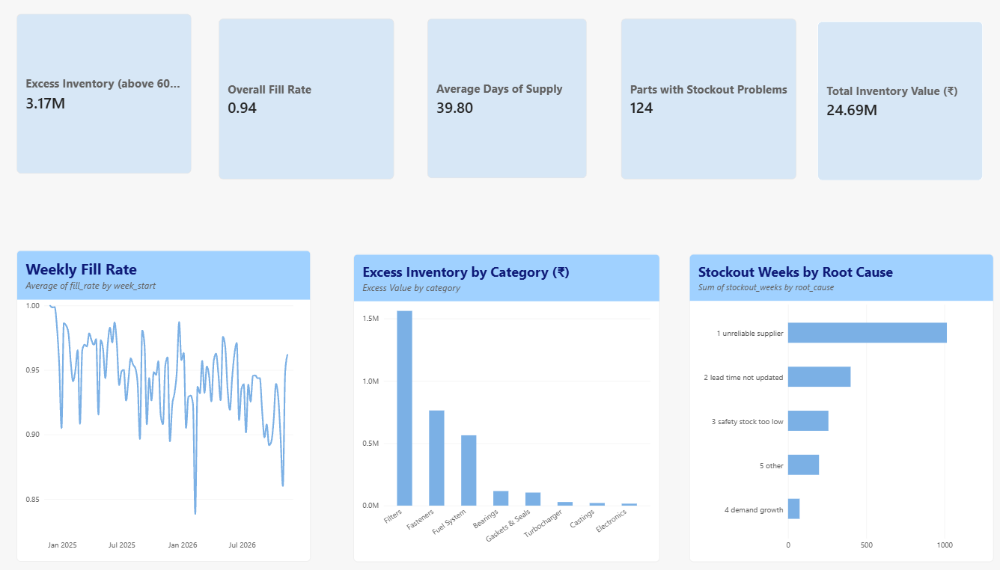
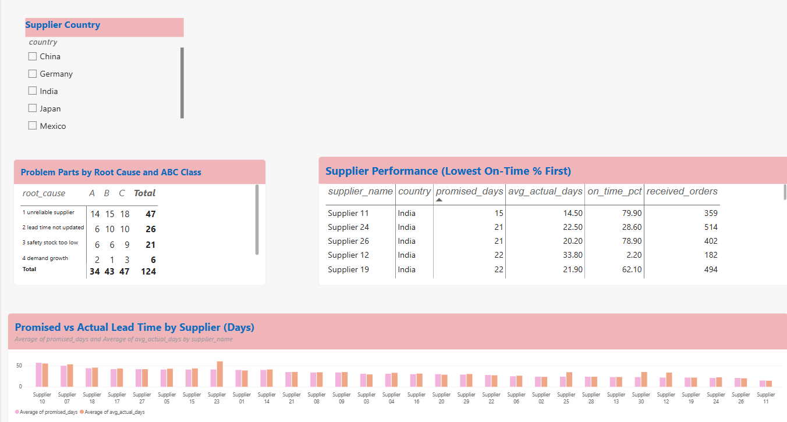
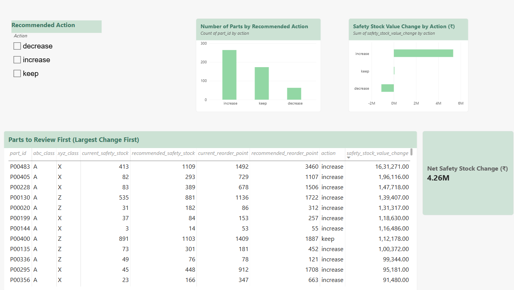

# Parts Availability & Inventory Control Tower

I built this to practise supply chain analytics on something that looks like a real plant problem. Some parts keep running out while others sit in the warehouse for months. I wanted to find out why, and what the planning numbers (lead time, safety stock, reorder point) should be instead.

Tools: PostgreSQL, Python (pandas, numpy), Power BI.

## The data

It's all synthetic, because real plant data isn't public. I wrote a Python script that makes 500 parts, 30 suppliers and 2 plants, with about two years of weekly demand, inventory and purchase orders.

The script orders parts using the PFEP reorder points (the planning sheet with one row per part). I made some of those numbers wrong on purpose, so the stockouts and excess stock happen naturally in the data. I also planted a few bad records: missing lead times, negative stock, duplicate PO lines and receipts dated before the order. The script saves an answer key of what I planted so I could check my own analysis against it.

## What I did

- Set up a star schema in PostgreSQL (`sql/01_schema.sql`) and loaded the data.
- Ran validation checks first. They found all the bad records, and I fixed them in views instead of touching the raw tables.
- Worked out ABC-XYZ classes, fill rate, days of supply and inventory turns for every part.
- Compared each supplier's promised lead time with what actually happened.
- Flagged parts where the PFEP lead time or safety stock doesn't match reality, then sorted every problem part into one root cause.
- Calculated what safety stock and reorder points should be in Python, using demand variability and lead time variability, and compared them with the current values.
- Built a 3 page Power BI report on top of it.

## What I found

- Overall fill rate is 94.4%. 124 of the 500 parts are below 95%.
- Most stockouts come from lead times, not from too little safety stock. About half the stockout weeks trace back to four suppliers that are almost always late. Another fifth come from lead times in the PFEP that were never updated. Low safety stock explains only about 13%.
- The most valuable parts (A class) have the lowest fill rate and the least stock cover. The cheap C parts hold the most.
- About 12.9% of inventory value is above a 60 day cover target, and one part holds 41% of that.
- The recommended parameters raise safety stock on 264 parts, lower it on 63 and leave 173 as they are.

## Dashboard





## Running it

You need PostgreSQL, Python 3 and Power BI Desktop.

```
pip install pandas numpy psycopg2-binary
```

1. Create a database called `parts_control_tower` and run `sql/01_schema.sql`.
2. Run `generate_data.py`. It creates a `data` folder with CSV files.
3. Put your PostgreSQL password in `load_to_postgres.py` and run it.
4. Run the SQL files `02` to `06` in order.
5. Put your password in `recommend_parameters.py` and run it.
6. Open the Power BI file and refresh.

## Things to keep in mind

- The data is made up, so this shows how I work and not results from a real plant.
- The 60 day target, the 95% fill rate cut-off, the 25% threshold for changing a parameter and the service levels (97, 95 and 90% for A, B and C parts) are my own choices.
- I didn't model holding cost or the cost of a stockout, so the extra safety stock I recommend isn't weighed against what the stockouts cost.
- The flat 60 day target is rough for parts with lumpy demand. Those need a target based on their variability.
